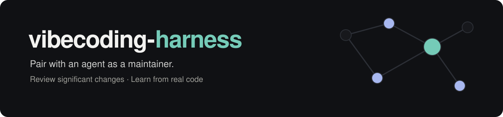
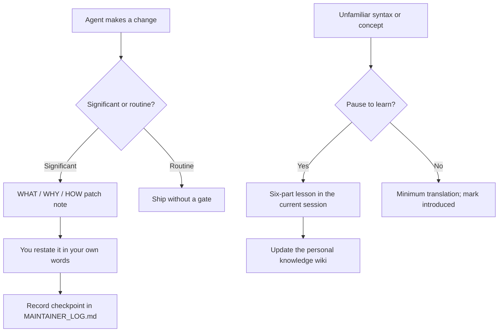

# vibecoding-harness

<div align="center">

<picture>
  <source media="(prefers-color-scheme: dark)" srcset="docs/assets/banner-dark.svg">
  <source media="(prefers-color-scheme: light)" srcset="docs/assets/banner-light.svg">
  
</picture>

**Review what changes. Learn what you need. Keep shipping.**

[](LICENSE)
[](dotfiles/CLAUDE.md)
[](#skills)
[](#use-readme-craft)

**[Quick start](#quick-start)** · **[How it works](#how-it-works)** · **[Skills](#skills)** · **[Examples](#examples)**

</div>

A portable Claude Code setup for pairing with an agent as a **maintainer**,
not a typist: significant changes come with a short restate-it-back check,
and optional lessons build your syntax-level reading fluency in a personal,
cumulative knowledge wiki. You never have to accept a lesson to keep moving.

This repository is a **template of instructions and skills**. You copy the
files into your agent's configuration; the agent follows the protocols.
Standalone skills can also be used with other agents that read files and run a shell.

## Contents

- [Why](#why)
- [Install / quick start](#quick-start)
- [How it works](#how-it-works)
  - [The Maintainer Protocol](#the-maintainer-protocol)
  - [The Learning Journal](#the-learning-journal)
- [Skills](#skills)
- [Layout](#layout)
- [Examples](#examples)
- [FAQ](#faq)
- [Contributing](#contributing)
- [License](#license)

## Why

You don't have to be the one typing the code to be responsible for the
system. But if you can't explain what changed and why, you're not really
reviewing it — you're just approving it. This harness makes that gap
visible instead of letting it quietly widen: every significant change
comes with a patch note and a check that you can say back what it does,
and every unfamiliar concept gets an optional, low-friction detour into a
wiki that's actually yours.

<a id="quick-start"></a>

## Install

You need **Git**, **Claude Code**, and a Bash-compatible shell for the commands
below (macOS or Linux). **Node.js 18+** is needed only if you run the
`readme-craft` scripts. Check your installed agent's skill locations against
[SETUP.md](SETUP.md); these paths are common defaults.

```bash
git clone https://github.com/thekusaldarshana/vibecoding-harness.git
cd vibecoding-harness

mkdir -p ~/.claude/skills ~/dev-knowledge
cp -n dotfiles/CLAUDE.md ~/.claude/CLAUDE.md
cp -Rn dotfiles/skills/learn-mode ~/.claude/skills/
cp -n dev-knowledge/index.md ~/dev-knowledge/index.md
```

> [!IMPORTANT]
> The `-n` copies preserve existing files. Edit `~/.claude/CLAUDE.md` to replace
> `{{YOUR_NAME}}` and fill in your languages/frameworks. If you already have a
> global rulebook, merge the two Protocol sections into it. If a skill already
> exists, compare and merge it manually; these commands do not update existing files.
> Keep your personal wiki index when installing again.

Optionally install the README skill, including its references and scripts:

```bash
cp -Rn dotfiles/skills/readme-craft ~/.claude/skills/
```

Check that the core files are in place:

```bash
test -f ~/.claude/CLAUDE.md
test -f ~/.claude/skills/learn-mode/SKILL.md
test -f ~/dev-knowledge/index.md
```

These checks exit successfully without output when the files exist. In a
Claude Code project session with the instructions and skill loaded, ask:

```text
/learn-mode Explain one unfamiliar construct in the code we're working on.
```

The lesson stays in that project session and records the concept in
`~/dev-knowledge/`. See [SETUP.md](SETUP.md) for the full manual setup and
[other agents](SETUP.md#installing-skills-in-other-agents).

<details>
<summary><b>Optional: a separate session for unattached study</b></summary>

You do not need to switch sessions to record a lesson. A separate session
is useful when you want study time that is not tied to a project:

```bash
cd ~/dev-knowledge
claude
```

Later, use `/resume` within Claude Code or:

```bash
claude --resume
```

Check `claude --help` and `/help` against your installed version before relying
on resume flags or personal-skill loading paths.

</details>

## How it works

### The Maintainer Protocol

Every non-trivial change gets classified as **SIGNIFICANT** or
**ROUTINE**:

| | Examples | What happens |
|---|---|---|
| **SIGNIFICANT** | new module/service, schema or data-flow change, new dependency or pattern, core business logic, security/auth, wide blast radius, or "I don't get this" | A three-part **Patch Note** (WHAT / WHY / HOW), then the agent asks you to restate it in your own words before marking it done. Logged to the project's `MAINTAINER_LOG.md`. |
| **ROUTINE** | styling, copy, formatting, lint fixes, an already-checkpointed pattern | Ships immediately. No gate. |

When it's unsure, it classifies toward SIGNIFICANT — never guesses toward
skipping the check. After 5 ROUTINE changes in a row with nothing
SIGNIFICANT in between, it triggers one lightweight zoom-out so things
never silently drift past what you could explain end to end.

### The Learning Journal

When the agent hits a teachable moment — new syntax, a language feature, a
CS concept — it doesn't lecture and doesn't silently skip it. It asks:

> "There's something we can learn here — want to pause and go into
> learning mode?"

Say no, and you get the minimum translation needed to keep moving, and the
concept is marked `introduced` for later. Say yes, and `/learn-mode` runs
a fixed six-part teaching shape (snippet → what it does → why it's here →
its formal name → the general problem it solves → what it connects to),
anchored to your actual code, and records it into a personal wiki at
`~/dev-knowledge/` that only grows from things you actually hit.

The two protocols keep review and learning connected without making every
change a lesson:



These are agent instructions: checkpoints depend on the agent loading and
following them. The repository does not install a hook that blocks changes.

## Skills

Standalone skills you can install on their own, with or without the protocols above:

| Skill | What it does |
| --- | --- |
| [`learn-mode`](dotfiles/skills/learn-mode/SKILL.md) | Teaches one concept in a fixed six-part shape and records it in `~/dev-knowledge/`. |
| [`readme-craft`](dotfiles/skills/readme-craft/SKILL.md) | Writes or restyles a rich, *accurate* README for any repo: it studies and runs the project first, hand-codes a light/dark SVG banner, captures real GIFs, uses GitHub-flavoured Markdown that actually renders, and verifies every link and anchor with a bundled checker. |

Skills are plain Markdown plus small zero-dependency Node scripts, so any agent that can read files and run a shell
can follow them (Claude Code, Codex, Cursor, Gemini CLI, Copilot). See [SETUP.md](SETUP.md#installing-skills-in-other-agents).

### Use readme-craft

Ask your agent:

```text
Use readme-craft to rewrite this repo's README.
```

From a repository checkout, you can also run its bundled tools directly:

```bash
node dotfiles/skills/readme-craft/scripts/make-banner.mjs --help
node dotfiles/skills/readme-craft/scripts/check-readme.mjs README.md
```

The checker verifies local links, anchors, image alt text, and obvious secret
patterns offline. External links are checked only with `--online`.
The tools use Node.js 18+ with no npm install step.

## Layout

```text
dotfiles/
  CLAUDE.md                        # global rulebook template (fill in {{YOUR_NAME}})
  skills/learn-mode/SKILL.md       # the /learn-mode skill
  skills/readme-craft/             # the /readme-craft skill: SKILL.md, references/, scripts/
dev-knowledge/
  index.md                         # empty starter hub for the knowledge wiki
examples/
  MAINTAINER_LOG.md                # what a project log looks like after a few checkpoints
  dev-knowledge/
    token-bucket-algorithm.md      # what one wiki concept file looks like
docs/assets/
  banner-light.svg                 # hand-coded README artwork for light mode
  banner-dark.svg                  # matching dark-mode artwork
SETUP.md                           # manual install instructions
CONTRIBUTING.md                    # scope and contribution guidance
```

This repo is a **template** — no one's name or personal details are in
it. Fill in `{{YOUR_NAME}}` in `dotfiles/CLAUDE.md` before installing. If
you want your own filled-in copy to sync across machines, keep that in a
*separate, private* repo — see the note in [FAQ](#faq).

## Examples

- [`examples/MAINTAINER_LOG.md`](examples/MAINTAINER_LOG.md) — two sample
  Patch Note entries, with the restated-in-your-own-words line included.
- [`examples/dev-knowledge/token-bucket-algorithm.md`](examples/dev-knowledge/token-bucket-algorithm.md)
  — one sample wiki concept file, in the six-part shape.

## FAQ

**Why two repos (this one + a private one)?**
This one is the reusable, name-redacted starting shape — meant to be
forked or cloned as-is. Your filled-in `CLAUDE.md` and your actual growing
`~/dev-knowledge/` wiki are personal and keep changing, so they belong in
a private repo you symlink into `~/.claude` and `~/dev-knowledge`, synced
separately across machines.

**Does this slow down routine work?**
No — ROUTINE changes (styling, copy, lint, an already-checkpointed
pattern) ship with no gate at all. The check only fires for changes with
real blast radius.

**What if the gate gets in the way?**
Say so — the protocol says explicitly: don't silently relax it under time
pressure, raise it and decide together whether to adjust it.

**The agent doesn't find `/learn-mode` or follow the protocols. What should I check?**
Confirm that your installed version loads the global rulebook and the skill
directory you copied into. Copy the whole skill folder, keep its `name:` field
consistent with the command, and consult
[the setup guide](SETUP.md#manual-setup) if `learn-mode` collides with an existing skill.

**Do I need Node.js for the protocols or learning journal?**
No. Those are Markdown instructions. Node.js 18+ is needed for the two
`readme-craft` helper scripts; running either script with an older runtime
can fail. There is no application server or package installation step.

**Why didn't reinstalling update my files?**
The quick start uses no-clobber copies. Compare the new template with your
installed files and merge deliberately, keeping your personal rules and wiki notes.

## Contributing

See [CONTRIBUTING.md](CONTRIBUTING.md) for scope and guidelines. Clearer
protocol wording, verified setup instructions, worked examples, and improvements
to the portable skills are welcome. Keep the template generic and personal details out.

## License

[MIT](LICENSE)
